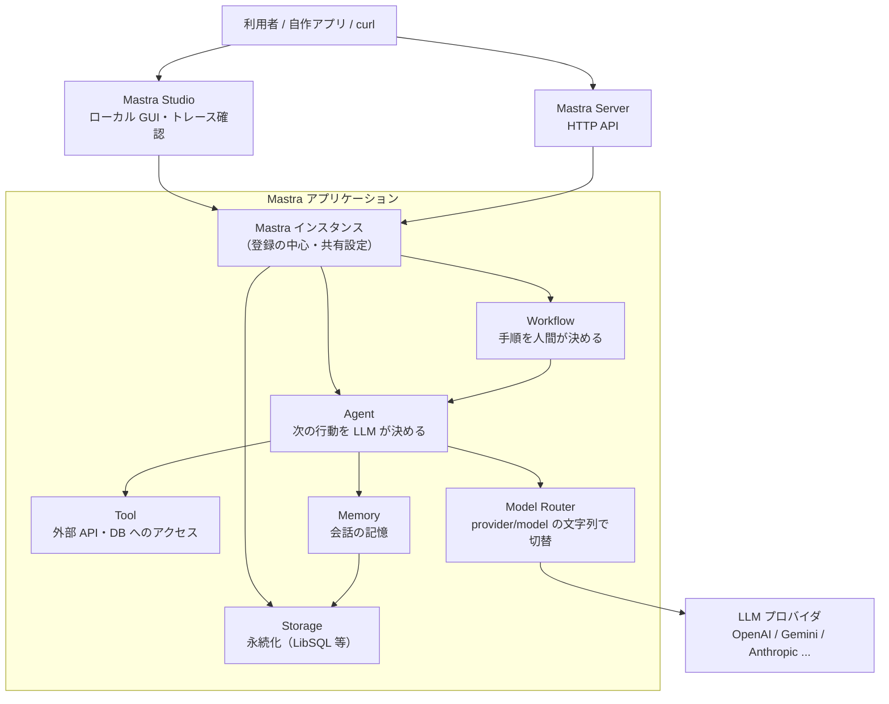

# 3. 全体像：構成要素マップ（8分）

## 3-1. 部品の関係

Mastra アプリの中心には **`Mastra` インスタンス**が1つあります。ここにエージェントやワークフローを登録すると、開発サーバー・Studio・HTTP API から使えるようになります。



## 3-2. 構成要素の一覧

| 要素 | 役割 | ハンズオンで触る |
|---|---|---|
| **Mastra インスタンス** | エージェント・ワークフロー・ストレージを登録する中心。`new Mastra({ ... })` | Day1 Step2 |
| **Agent** | LLM とツールを使い、次の行動を自分で決めてタスクを解く主体 | Day1 Step2 |
| **Tool** | エージェントが呼び出せる関数。天気 API、DB 検索、社内システム連携など | Day1 Step4 |
| **Workflow** | 手順が決まっている多段処理を、ステップのグラフとして明示的に組む | Day2 Step8 |
| **Memory** | 会話履歴やユーザー固有情報を保持して、次のやり取りに引き継ぐ | Day2 Step7 |
| **Storage** | Memory やトレースの保存先。ローカルは LibSQL（SQLite 互換）が既定 | Day2 Step7 |
| **Model Router** | `'openai/gpt-5.6-luna'` のような文字列だけでモデルを切り替える仕組み | Day1 Step2 |
| **Studio** | ローカル GUI。対話・ワークフロー実行・トレース確認 | Day1 Step1 |
| **Server** | エージェントを HTTP API として公開する仕組み | Day1 Step5 |
| **Scorers / Evals** | 出力の品質を自動採点する仕組み | Day2 Step11 |

**理解の要点は Agent と Workflow の使い分けです。** 公式の整理は「**手順が事前に決まっていないタスクは Agent、決まっている多段処理は Workflow**」です。詳しくは6章で扱います。

## 3-3. プロジェクトのディレクトリ構成

Mastra アプリの実体は、ごく普通の Node/TypeScript プロジェクトです。骨格は共通しています。

```
project-root/
├── package.json / tsconfig.json
├── .env
├── src/
│   ├── index.ts              # （任意）自作の実行スクリプト
│   └── mastra/
│       ├── index.ts          # Mastra インスタンス（エントリーポイント）
│       ├── agents/           # Agent 定義
│       ├── tools/            # Tool 定義
│       ├── workflows/        # Workflow 定義
│       └── public/           # 実行時に生成される SQLite 等
└── .mastra/                  # ビルド/開発サーバーの生成物（Git 管理外）
```

| フォルダ / ファイル | 役割 |
|---|---|
| `src/mastra/index.ts` | `new Mastra({...})` 本体。ここに登録したものだけが Studio・HTTP API から見える |
| `src/mastra/agents/` | Agent 定義（4章） |
| `src/mastra/tools/` | Tool 定義（5章） |
| `src/mastra/workflows/` | Workflow 定義（6章） |
| `src/mastra/public/` | ストレージの相対パスが解決される先。実行時に `*.db`（と `-wal`/`-shm`）が生成される |
| `src/index.ts` | Mastra 本体とは別に、`generate()`/`stream()` などで呼び出す自作スクリプトの置き場。Mastra が要求するものではない |
| `.mastra/` | `mastra dev` / `mastra build` が作るビルド出力。手で編集しない。デプロイ元にもなる（8-4） |

> ストレージファイルの解決先の詳しい仕組みは [reference/mastra-studio.md](../reference/mastra-studio.md) 7章を参照。

**公式テンプレート限定の付属物に注意**: `create-mastra` でテンプレートを展開したプロジェクト直下には `.agents/` フォルダや `skills-lock.json` も見えますが、これは Mastra のランタイムとは無関係な、AI コーディングエージェント（Claude Code 等）向けの Agent Skills です。`src/mastra/agents/` とは別物なので混同しないでください。詳細は [reference/agent-skills.md](../reference/agent-skills.md)。
