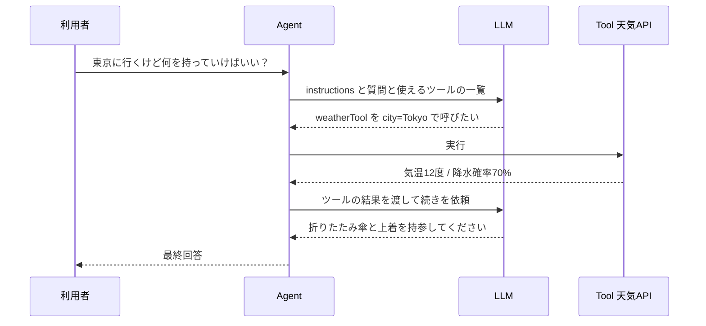

# 4. Agent — 次の行動を LLM が決める（5分）

## 4-1. 定義のしかた

エージェントの定義は、およそ次の形に収まります。**前半の4つが最小構成**で、`tools` から下は必要になったときに足していく任意の項目です。

```ts
import { Agent } from '@mastra/core/agent';
import { Memory } from '@mastra/memory';
import { createAnswerRelevancyScorer } from '@mastra/evals/scorers/prebuilt';
import { weatherTool } from '../tools/weather-tool.ts';

export const travelAgent = new Agent({
  // ここまでが最小構成。まずはこの4つだけで動く
  id: 'travel-agent',
  name: 'Travel Agent',
  instructions: 'あなたは旅行アドバイザーです。天気を調べてから持ち物を提案してください。',
  model: 'openai/gpt-5.6-luna',

  // ここから下は任意
  tools: { weatherTool },                                   // 使わせる道具（5章）

  memory: new Memory({ options: { lastMessages: 20 } }),    // 直近20件を文脈に含める（7章）

  scorers: {                                                // 出力を自動採点する（8章）
    relevancy: {
      scorer: createAnswerRelevancyScorer({ model: 'openai/gpt-5.6-luna' }),
      sampling: { type: 'ratio', rate: 0.5 },               // 50% だけ採点してコストを抑える
    },
  },
});
```

| プロパティ | 役割 |
|---|---|
| `id` | 一意の識別子。API のパスや Studio の表示で使われる |
| `name` | 人間向けの表示名 |
| `instructions` | **システムプロンプト**。エージェントの役割・守るべきルール・出力の方針を書く。最も品質を左右する |
| `model` | 使う LLM。`'provider/model'` 形式の文字列で指定する（プロバイダを `import` する必要がない） |
| `tools` | 使わせるツールの一覧（5章） |
| `memory` | 会話を記憶させる設定（7章） |
| `scorers` | 出力を自動採点する設定（8章） |

> 💡 **上の表は主要なものに絞った一覧で、設定項目はほかにもあります。** たとえば `workflows` を渡すと、エージェントが**ワークフローを呼べる**ようになります（ワークフロー側からエージェントを呼ぶ逆向きは 6-4）。ハンズオンでは [day2/08-workflow.md](../03-handson/day2/08-workflow.md) §8-7 で扱います。

> 💡 `model` に文字列を渡すだけで済むのが **Model Router** の効果です。OpenAI から Gemini への切り替えも1行の書き換えで済みます。ハンズオンでは `'openai/gpt-5.6-luna'` を使います（[01-setup/02-llm.md](../01-setup/02-llm.md) 参照）。

> 💡 `tools` は**配列ではなくオブジェクト**です。`{ weatherTool }` は `{ weatherTool: weatherTool }` の省略形で、左側のキーがそのまま登録名になります。

> ⚠️ `memory` は指定しただけでは動きません。保存先として `Mastra` インスタンス側に **Storage** の設定が必要です（7-3）。

## 4-2. エージェントが動くときに起きていること

`travelAgent` に「東京に行くけど何を持っていけばいい？」と尋ねたときの内部の流れです。



重要なのは、**「天気を調べる」という手順をコードに書いていない**点です。`instructions` とツールの説明文から、LLM が「まず天気を調べる必要がある」と判断しています。これが Agent の性質です。

## 4-3. 応答の受け取り方は3通り

| 方式 | 使う場面 | イメージ |
|---|---|---|
| **生成（generate）** | 完成した回答をまとめて受け取る。バッチ処理向き | 全部できてから1回返る |
| **ストリーミング（stream）** | 生成中の文字を順次表示する。チャット UI 向き | 少しずつ返り続ける |
| **構造化出力** | 文章ではなく決まった形の JSON で受け取る。後続処理に渡す用 | `{ city, temp, items[] }` |

構造化出力は Zod でスキーマを書いて指定します。ハンズオン Day1 Step3 で3つとも試します。

> ⚠️ 構造化出力のスキーマには、モデルによって使えない記法があります（Google のモデルでは `z.union` や `z.record` が通らない等）。ハンズオンで使う OpenAI では基本形のスキーマがそのまま通りますが、他プロバイダへ差し替える際は [01-setup/02-llm.md](../01-setup/02-llm.md) 6章と [troubleshooting/](../troubleshooting/) §5 を参照してください。
