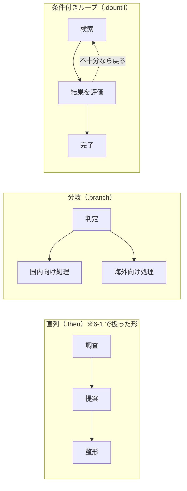
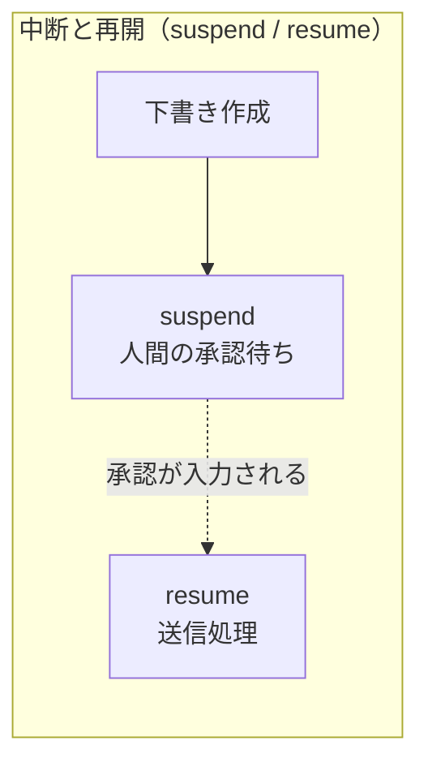

# 6. Workflow と、Agent との使い分け（12分）

## 6-1. ワークフローの書き方

**ステップ（部品）を定義し、それを繋いでワークフロー（組み立て図）にする**、という2段構えです。

```ts
import { createStep, createWorkflow } from '@mastra/core/workflows';
import { z } from 'zod';

// ── 部品1: 都市名を受け取って天気を返す ──
const research = createStep({
  id: 'research',
  inputSchema: z.object({ city: z.string() }),
  outputSchema: z.object({ weather: z.string() }),
  execute: async ({ inputData }) => ({ weather: `${inputData.city} は雨` }),
});

// ── 部品2: 天気を受け取って持ち物の提案を返す ──
const suggest = createStep({
  id: 'suggest',
  inputSchema: z.object({ weather: z.string() }),    // ← research の outputSchema と同じ形にする
  outputSchema: z.object({ result: z.string() }),
  execute: async ({ inputData }) => ({ result: `${inputData.weather}。傘を持っていってください` }),
});

// ── 組み立て図: 部品をどの順番で動かすか ──
export const tripWorkflow = createWorkflow({
  id: 'trip-workflow',
  inputSchema: z.object({ city: z.string() }),       // ← 最初の部品 research の入力と同じ形
  outputSchema: z.object({ result: z.string() }),    // ← 最後の部品 suggest の出力と同じ形
})
  .then(research)   // 1番目に research を動かす
  .then(suggest)    // research の出力を、そのまま suggest の入力として渡す
  .commit();        // 組み立て完了。これで実行できる状態になる
```

### `createStep` と `.then()` の役割の違い

`createStep` は**部品を作るだけ**で、それ自体は誰にも呼ばれません。上のコードで `research` を定義しただけの状態では、まだ何も起きません。
`.then(research)` を書いて初めて、「このワークフローの中で、この部品をこの順番で動かす」という登録が行われます。

| 書くもの | やっていること |
|---|---|
| `createStep({ ... })` | 部品を1つ作る。単体では動かない |
| `.then(research)` | 作った部品を、実行順の**次の位置に登録する**。戻り値もワークフローなので `.then()` を続けて繋げる |
| `.commit()` | 組み立てを確定させる。**これを忘れると実行できない** |

### データがどう流れるか

`.then()` で繋いだステップは、**前の出力がそのまま次の入力になります**。

```text
入力  { city: '東京' }
  │
  ▼  research      都市名 → 天気
      { weather: '東京 は雨' }
  │
  ▼  suggest       天気 → 提案
出力  { result: '東京 は雨。傘を持っていってください' }
```

そのため、隣り合うスキーマの形が揃っている必要があります。揃えるべき箇所は3つです。

| 揃える箇所 | 一致させるもの |
|---|---|
| ワークフローの入口 | `tripWorkflow` の `inputSchema` ＝ 最初のステップ `research` の `inputSchema` |
| ステップとステップの間 | `research` の `outputSchema` ＝ `suggest` の `inputSchema` |
| ワークフローの出口 | 最後のステップ `suggest` の `outputSchema` ＝ `tripWorkflow` の `outputSchema` |

この連結は**型でも保証されます**。前のステップの `outputSchema` がそのまま次の `inputSchema` に繋がるため、形が合っていなければ実行する前（コンパイル時）にエディタが教えてくれます。

> 💡 形が揃わない部品同士を繋ぎたいときは、あいだに `.map()` を挟んでデータを変換します（`.then(research).map(...).then(suggest)`）。既存のステップを再利用するときによく使います。

## 6-2. 制御フロー — 並列・分岐・ループ

直列（`.then()`）だけでなく、**並列・条件分岐・条件付きループも用意されています**。いずれもワークフローに繋げて書きます。



### 使えるメソッド

| 書き方 | 何をするか | 備考 |
|---|---|---|
| `.then(step)` | 直列。前の出力が次の入力になる | 6-1 で使ったもの |
| `.parallel([a, b])` | 並列。全部終わるまで次へ進まない | 出力は `{ ステップID: 結果 }` の形になる |
| `.branch([[cond, a], [cond, b]])` | 条件分岐。合致した枝だけ実行する | 実行されない枝があるので、後続の `inputSchema` は `.optional()` にする |
| `.dountil(step, cond)` | `cond` が **true になるまで**繰り返す | 条件付きループ |
| `.dowhile(step, cond)` | `cond` が **true である間**繰り返す | 条件付きループ |
| `.foreach(step, { concurrency })` | 配列の各要素に同じステップを適用する | 入力が配列型であること。`concurrency` の既定は `1`（逐次） |

条件 `cond` は `async ({ inputData, iterationCount }) => boolean` の形の関数です。

### 条件分岐の書き方

「行き先が国内か海外かで処理を分ける」を `.branch()` で書くとこうなります。

```ts
// ── 判定: 分岐の材料になる情報を付けて渡す ──
const classify = createStep({
  id: 'classify',
  inputSchema: z.object({ city: z.string() }),
  outputSchema: z.object({ city: z.string(), isDomestic: z.boolean() }),
  execute: async ({ inputData }) => ({
    city: inputData.city,
    isDomestic: ['東京', '大阪', '札幌'].includes(inputData.city),
  }),
});

// ── 枝1・枝2: どちらも classify の出力をそのまま受け取る ──
const domestic = createStep({
  id: 'domestic',
  inputSchema: z.object({ city: z.string(), isDomestic: z.boolean() }),
  outputSchema: z.object({ advice: z.string() }),
  execute: async ({ inputData }) => ({ advice: `${inputData.city} は国内。身分証だけで行けます` }),
});

const overseas = createStep({
  id: 'overseas',
  inputSchema: z.object({ city: z.string(), isDomestic: z.boolean() }),
  outputSchema: z.object({ advice: z.string() }),
  execute: async ({ inputData }) => ({ advice: `${inputData.city} は海外。パスポートが必要です` }),
});

// ── 合流: 動かなかった枝は undefined で届くので .optional() が要る ──
const report = createStep({
  id: 'report',
  inputSchema: z.object({
    domestic: z.object({ advice: z.string() }).optional(),   // ← キーは枝ステップの id
    overseas: z.object({ advice: z.string() }).optional(),
  }),
  outputSchema: z.object({ result: z.string() }),
  execute: async ({ inputData }) => ({
    result: inputData.domestic?.advice ?? inputData.overseas?.advice ?? '判定できませんでした',
  }),
});

export const tripBranchWorkflow = createWorkflow({
  id: 'trip-branch-workflow',
  inputSchema: z.object({ city: z.string() }),
  outputSchema: z.object({ result: z.string() }),
})
  .then(classify)
  .branch([
    // [条件, 条件が true のとき動かすステップ] の組を並べる
    [async ({ inputData }) => inputData.isDomestic, domestic],
    [async ({ inputData }) => !inputData.isDomestic, overseas],
  ])
  .then(report)
  .commit();
```

読むときの要点は3つです。

| 要点 | 内容 |
|---|---|
| 枝の入力 | どの枝も**分岐の直前のステップの出力**をそのまま受け取る。枝ごとに入力の形が変わるわけではない |
| 分岐後の出力 | 動いた枝の結果が `{ 枝ステップの id: その出力 }` の形にまとまって次へ流れる |
| `.optional()` | 動かなかった枝のキーは `undefined` になる。合流ステップの `inputSchema` で `.optional()` を付けないと検証に失敗する |

> ⚠️ **条件はすべて評価され、true になった枝は「すべて」実行されます**（複数合致したときは並列）。`if / else if` のように「上から順に見て最初の1つだけ」ではありません。排他にしたいときは、上の例のように条件どうしが打ち消し合う形（`isDomestic` と `!isDomestic`）で書きます。どの条件も false なら**どの枝も動かず**、合流ステップには空の入力が渡ります。

### 条件付きループの書き方

「結果が十分になるまで検索を繰り返す」を `.dountil()` で書くとこうなります。

```ts
export const searchWorkflow = createWorkflow({ /* ... */ })
  .then(planStep)
  // searchStep を実行 → 条件を評価 → false ならもう一度 searchStep、を繰り返す
  .dountil(searchStep, async ({ inputData, iterationCount }) => {
    if (iterationCount >= 4) throw new Error('繰り返し回数の上限に達しました');
    return inputData.isEnough;    // true になったらループを抜ける
  })
  .then(answerStep)
  .commit();
```

> ⚠️ **`.dountil()` と `.dowhile()` は後判定です。** ステップを最低1回実行してから条件を評価するため、「条件によっては1回も実行しない」は書けません。0回で抜けたい場合は手前に `.branch()` を置いてループごと迂回させます。

> ⚠️ **無限ループの上限は自分で書きます。** 条件関数が受け取る `iterationCount`（初回評価時は `1`）を見て打ち切ってください。上の例の `iterationCount >= 4` がそれです。なお条件関数の中で `throw` すると、`start()` が**例外で reject されます**（`status: 'failed'` の結果としては返りません）。エラーにせず抜けたいときは `return true` を返します。

> ⚠️ **ループ本体の入力と出力は同じ形にします。** 2周目以降、本体の入力は直前のステップの出力ではなく**本体自身の前回の出力**になります。出力が入力に必要な項目を欠くと、**型チェックは通るのに2周目で `Step input validation failed` になります**。条件関数の `inputData` は、本体が今回返した出力です。

> 💡 条件関数は `inputData` と `iterationCount` のほか `getStepResult` / `getInitData` / `mastra` も受け取れます。そのため**ループの中でエージェントに「まだ調べ足りないか」を自己評価させ、その結果で継続を判断する**構成が組めます。また `.dountil()` や `.foreach()` の第1引数には、`createWorkflow(...).commit()` した**ワークフローそのものを渡せます**。複数ステップをひとまとまりとして繰り返したいときに使います。

> 💡 分岐とループは [03-handson/day2/08-workflow.md](../03-handson/day2/08-workflow.md) の §8-4（`.branch()`）と §8-5（`.dountil()` / `.dowhile()`）で実際に書けます。

> 💡 実際に動くループは [02-templates/05-deep-search.md](../02-templates/05-deep-search.md) §4-2 で読めます。Deep Search テンプレートは `evaluate-results` ステップの自己評価をもとに、十分と判断されるか4周するまで `.dountil()` で検索をやり直します。ループが Mastra Studio の画面でどう描かれるかは [reference/mastra-studio.md](../reference/mastra-studio.md) §5-4 を参照してください。

## 6-3. 中断と再開（suspend / resume）

制御フローと違い、こちらは**処理の途中で人間を待つ**ための仕組みです（human-in-the-loop）。



| 仕組み | 内容 |
|---|---|
| **suspend / resume** | 途中で処理を止め、人間の入力や承認を待ってから再開できる（human-in-the-loop） |
| スナップショット | 中断時の状態が保存されるため、サーバーが落ちても最後のステップから再開できる |

### ステップ側の書き方

`suspend()` を呼ぶとワークフローはその場で止まり、実行状態が保存されます。人間の入力を受け取って
`resume()` すると、**止まったステップの `execute` が先頭から再実行**されます。1回目は `resumeData` が空、
2回目は入っている——この違いで初回と再開を見分けるのが定石です。

```ts
// ── 下書き: ここは普通のステップ ──
const draftPlan = createStep({
  id: 'draft-plan',
  inputSchema: z.object({ city: z.string() }),
  outputSchema: z.object({ plan: z.string() }),
  execute: async ({ inputData }) => ({ plan: `${inputData.city} 2泊3日の旅程案 …` }),
});

// ── 承認待ち: ここで止めて人間の判断を待つ ──
const approve = createStep({
  id: 'approve',
  inputSchema: z.object({ plan: z.string() }),
  outputSchema: z.object({ plan: z.string(), approved: z.boolean() }),

  suspendSchema: z.object({ plan: z.string(), question: z.string() }),   // ワークフロー → 人間（画面に出る）
  resumeSchema: z.object({ approved: z.boolean() }),                     // 人間 → ワークフロー（入力欄になる）

  execute: async ({ inputData, resumeData, suspend }) => {
    // 1回目: resumeData が無い → 中断して人間の入力を待つ
    if (!resumeData) {
      return suspend({ plan: inputData.plan, question: 'この旅程で確定してよいですか？' });
    }
    // 2回目（resume 後）: resumeData が入っている → 続きを実行する
    return { plan: inputData.plan, approved: resumeData.approved };
  },
});

// ── 送信: 承認されたときだけ本処理を行う ──
const sendPlan = createStep({
  id: 'send-plan',
  inputSchema: z.object({ plan: z.string(), approved: z.boolean() }),
  outputSchema: z.object({ result: z.string() }),
  execute: async ({ inputData }) => ({
    result: inputData.approved ? `送信しました: ${inputData.plan}` : '差し戻されました',
  }),
});

export const approvalWorkflow = createWorkflow({
  id: 'approval-workflow',
  inputSchema: z.object({ city: z.string() }),
  outputSchema: z.object({ result: z.string() }),
})
  .then(draftPlan)
  .then(approve)
  .then(sendPlan)
  .commit();
```

### 呼び出し側の書き方

```ts
// Mastra インスタンスに登録済みのワークフローを取り出して実行を作る
const run = await mastra.getWorkflow('approvalWorkflow').createRun();

const first = await run.start({ inputData: { city: '東京' } });

if (first.status === 'suspended') {
  // first.suspendPayload に suspend() へ渡した値が入っている（＝人間に見せる内容）。
  // ただしステップの id でくるまれる: { approve: { plan, question } }
  const final = await run.resume({
    step: 'approve',                  // 再開するステップの id
    resumeData: { approved: true },   // resumeSchema の形で答える
  });
  console.log(final.status);          // 'success'
}
```

| 書くもの | 役割 |
|---|---|
| `suspendSchema` | 中断時に**人間へ渡す**値の形。Studio ではここに入れた値が画面に表示される |
| `resumeSchema` | 再開時に**人間から受け取る**値の形。Studio ではこの形の入力フォームが自動生成される |
| `suspend(payload)` | 呼ぶとその場で中断する。`execute` の戻り値としてそのまま `return` する |
| `resumeData` | resume 時に渡された値。**1回目は `undefined`**。初回か再開かの判定に使う |
| `run.resume({ step, resumeData })` | 中断中の run を再開する。`step` には再開するステップの `id` を渡す |

> 💡 中断中の状態は Storage（7章）にスナップショットとして保存されます。そのため**プロセスが落ちても、別のリクエストからでも、`runId` を指定すれば再開できます**。承認が翌日になっても構いません。Studio や HTTP API から resume する手順は [reference/mastra-studio.md](../reference/mastra-studio.md) §5-2 と [02-templates/05-deep-search.md](../02-templates/05-deep-search.md) §4-2 を参照してください。

> 💡 suspend / resume は [03-handson/day2/08-workflow.md](../03-handson/day2/08-workflow.md) の §8-6 で実際に書けます。実物は [02-templates/05-deep-search.md](../02-templates/05-deep-search.md) §4-2 の Deep Search テンプレートでも体験できます。

## 6-4. 使い分けの判断表

Agent と Workflow は二者択一ではありません。ステップの中では**エージェントを呼ぶこともできます**。「調査はワークフローで確実に、文章生成はエージェントで柔軟に」という組み合わせが実務では多くなります。

| 状況 | 選ぶもの | 理由 |
|---|---|---|
| 何を何回やるかは状況次第 | **Agent** | 判断を LLM に任せる前提の仕組み |
| 手順が固定で、順序を必ず守らせたい | **Workflow** | 実行順序をコードで保証できる |
| 途中に人間の承認を挟みたい | **Workflow** | suspend / resume がある |
| どのステップで失敗したか特定したい | **Workflow** | ステップ単位でトレースが分かれる |
| 同じ処理でも入力によって手順が変わる | **Agent** または分岐付き Workflow | 変動幅が小さいなら分岐で書くほうが安定する |
| 出力の再現性を重視する | **Workflow** | LLM の判断が入る箇所を減らせる |

> 💡 実務では「**Workflow を骨格にして、判断が必要なステップだけ Agent を呼ぶ**」構成が扱いやすくなります。エージェントに全部任せると、動くけれど毎回振る舞いが変わって原因究明が難しくなりがちです。
