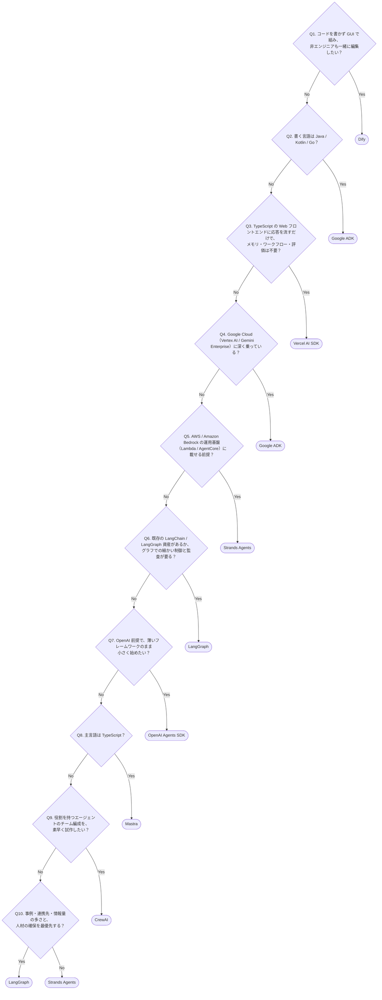

# 10. 他フレームワークとの比較（9分）

比較対象は、TypeScript 圏と Python 圏それぞれの主要どころから8つ選びました。最後の Dify だけは性質が異なり、コードを書くライブラリではなく **GUI で組み立てるプラットフォーム**です（[10-3](#10-3-メリットデメリット向く場面) の💡を参照）。

## 10-1. 基本情報

| フレームワーク | 主言語 | 開発元 | ライセンス | 一言でいうと |
|---|---|---|---|---|
| **Mastra** | TypeScript | Kepler Software（YC W25） | Apache 2.0（`ee/` 配下のみ source-available） | TypeScript で一式そろったエージェント基盤 |
| **LangChain + LangGraph** | Python / JS | LangChain, Inc. | MIT（後述の注意あり） | 最大のエコシステム。グラフで細かく制御する |
| **Google ADK** | Python / TypeScript / Java / Go / Kotlin | Google | Apache 2.0 | Google Cloud と密結合。プロトコル対応が厚い。対応言語が最も広い |
| **Strands Agents** | Python / TypeScript | Amazon Web Services | Apache 2.0（後述の注意あり） | Amazon 社内の本番運用から生まれた AWS 製。Python と TypeScript の両方が本家 |
| **CrewAI** | Python | CrewAI, Inc. | MIT | 役割を持つエージェントのチーム編成が最も手軽 |
| **OpenAI Agents SDK** | Python / JS | OpenAI | MIT | 薄く小さい。OpenAI の基盤に最短で乗る |
| **Vercel AI SDK** | TypeScript | Vercel | Apache 2.0 | Web UI へ LLM 応答を流し込むためのライブラリ |
| **Dify** | Python / TypeScript（利用者はコードを書かない） | LangGenius, Inc.（米国。日本法人あり） | Dify Open Source License（Apache 2.0 + 追加条件。後述の注意あり） | GUI でエージェント・ワークフロー・RAG を組む LLM アプリ開発プラットフォーム |

> ⚠️ **LangGraph のライセンスは要注意です。** `langchain-core` や `langgraph` 本体は MIT ですが、サーバーランタイムである `langgraph-api` は **Elastic License 2.0** です。本番でこのランタイムを運用するには商用ライセンスキー（Enterprise プラン相当）が必要になります。「MIT だから自由」と早合点しないでください。

> ⚠️ **Strands Agents は「SDK」と「AWS のマネージドサービス」を分けて考えてください。** SDK 本体は全機能が Apache 2.0 で、有償ティアも座席課金もありません。ただし長期記憶・認証・ゲートウェイ・本番実行基盤を担う **Amazon Bedrock AgentCore** は AWS の有償マネージドサービスです。「Strands なら全部無料」ではなく「SDK は無料、AWS に寄せた運用機能は AWS の課金対象」と理解してください。

> ⚠️ **Dify のライセンスは Apache 2.0 そのものではありません。** 「Dify Open Source License（Apache 2.0 をベースに追加条件を付けたもの）」で、①書面の許諾なく **Dify のソースコードでマルチテナント環境を運用してはならない**、②**Dify コンソール／アプリ上の LOGO・著作権表示を削除・改変してはならない**、の2つが加わります。シングルテナントの自社ホストで社内利用する分には問題ありませんが、**Dify を土台に外部向けの SaaS を提供する場合は商用ライセンスが必要**です。

📖 <b>補足：Strands Agents の来歴とリポジトリ再編</b>（ネット上の情報が食い違って見えるときに読んでください）

Strands Agents は動きが速く、**検索で出てくる記事が古いリポジトリを指していることがよくあります**。2026-08-17 時点の状況を整理します。

| 時期 | 出来事 |
|---|---|
| 2025年5月 | AWS が Python 版をプレビューとして OSS 公開 |
| 2025年7月 | Python 版 1.0。マルチエージェント基本要素と A2A 対応が入る |
| 2025年12月 | TypeScript 版をプレビュー公開 |
| 2026年4月30日 | **TypeScript 版 1.0**（GA） |
| 2026年5月12日 | 各リポジトリを **`strands-agents/harness-sdk` モノレポへ統合**（Python・TypeScript・ドキュメントを同居） |
| 2026年6月3日 | 旧 `strands-agents/sdk-typescript` をアーカイブ |

- 現在の正しい参照先は https://github.com/strands-agents/harness-sdk と https://strandsagents.com/ です。
- パッケージ名は Python が `strands-agents`（PyPI）、TypeScript が `@strands-agents/sdk`（npm）。TypeScript は Node.js 20 以上。
- 「Strands Agents SDK」と「Amazon Bedrock AgentCore」は別物です。前者が OSS のエージェント実装ライブラリ、後者がそれを本番運用するための AWS マネージドサービス群です。
- Amazon 社内では Amazon Q Developer、AWS Glue、VPC Reachability Analyzer などの本番機能で使われていると公表されています。

## 10-2. 機能マトリクス

凡例: **○** = 標準で備える / **△** = 限定的、または別サービス・別パッケージが必要 / **−** = 対象外

| 機能 | Mastra | LangGraph | Google ADK | Strands Agents | CrewAI | OpenAI Agents SDK | Vercel AI SDK | Dify |
|---|---|---|---|---|---|---|---|---|
| 組み込みメモリ | ○ | △ | ○ | △ | ○ | △ | − | ○ |
| 明示的なワークフロー | ○ | ○ | ○ | ○ | ○ | △ | − | ○ |
| ローカル GUI 開発環境 | ○ | ○ | ○ | − | △ | △ | − | ○ |
| 品質評価（Evals） | ○ | △ | ○ | △ | △ | △ | − | △ |
| トレース・可観測性 | ○ | △ | ○ | ○ | △ | ○ | △ | ○ |
| MCP 対応 | ○ | ○ | ○ | ○ | ○ | ○ | ○ | ○ |
| A2A 対応 | ○ | △ | ○ | ○ | △ | − | − | △ |
| サーバーレス適合 | ○ | △ | ○ | ○ | ○ | ○ | ○ | − |

> ⚠️ この表は 2026-08-11 時点（Strands Agents の列のみ 2026-08-17 時点、Dify の列のみ 2026-08-22 時点）の各公式ドキュメントに基づく目安です。どのプロジェクトも更新が速いため、採用判断の際は必ず公式を確認してください。

以下は、説明が要るセルの根拠です。見出しがフレームワーク（表の列）、各項目の「機能＋記号」が表のセルに対応します。

### Mastra の「○」はなぜか

**サーバーレス適合「○」** — **常駐プロセスを前提にしない設計**だからです。根拠は4点あります。

| 根拠 | 内容 |
|---|---|
| **成果物が単一バンドル** | ビルドすると `.mastra/` 配下に出力されます。API・ワーカー・DB・デーモンといった常駐サービス群を自分で並べる必要がありません（[08-devops.md](08-devops.md) §8-4） |
| **状態をすべて Storage に外出し** | 会話履歴だけでなく、ワークフローのスナップショットもトレースも Storage に入ります。プロセスのメモリ上に状態を抱えないため、リクエストごとに使い捨てられる実行環境でも成立します（[07-memory-storage.md](07-memory-storage.md) §7-3） |
| **中断・再開がスナップショット方式** | 承認待ちのような長い待機を、プロセスを生かし続けるのではなく保存済みスナップショットの読み戻しで実現します。実行時間に上限のある環境と相性がよいのはここが効いています（[06-workflow.md](06-workflow.md) §6-3） |
| **Server 層が Web 標準寄り** | HTTP API は内部で Hono を使っており、Node.js 以外のエッジランタイムでも動きます（[08-devops.md](08-devops.md) §8-2） |

> ⚠️ **「○」は無条件ではありません。** Storage をローカル既定の `file:./mastra.db` のままにすると、ディスクが永続しない環境では消えます。Turso や PostgreSQL などネットワーク越しの保存先へ差し替えるのが前提です。Metrics の既定である DuckDB も同じ理由で動きません（[Day2 Step 10](../03-handson/day2/10-observability.md)）。

### 他フレームワークの記号の根拠

| フレームワーク | 該当セル | なぜその記号か |
|---|---|---|
| **LangGraph** | 組み込みメモリ「△」 | checkpointing（状態の永続化）が中心で、意味的に過去を思い出す機能は別途組み立てが必要です |
| **LangGraph** | 品質評価「△」・トレース「△」 | LangChain 陣営は LangSmith という別サービスが実質の標準です（無料枠あり、本格利用は有償）。Mastra と Google ADK はフレームワーク側に含まれます |
| **LangGraph** | サーバーレス適合「△」 | 本番ランタイムの **LangGraph Platform** が設計上 Vercel / Cloudflare Workers では動きません。サーバーレス前提なら確認が必要です |
| **Google ADK** | MCP「○」・A2A「○」 | 両方を一級市民として扱っています |
| **Strands Agents** | 組み込みメモリ「△」 | 会話履歴の永続化（ローカルファイル / Amazon S3）と文脈の圧縮（スライディングウィンドウ・要約）までが標準です。意味的な想起や会話をまたぐ長期記憶は Amazon Bedrock AgentCore Memory などの外部サービスに委ねる設計のため △ としています |
| **Strands Agents** | 明示的なワークフロー「○」 | Graph（依存関係を明示する決定的な有向グラフ）・Swarm（エージェント同士が自律的に引き継ぐ）・Agents-as-Tools の3パターンが標準で用意されています |
| **Strands Agents** | ローカル GUI「−」・トレース「○」 | Mastra Studio に相当する公式のローカル GUI がありません。ただしトレースは OpenTelemetry で標準的に出力されるため、Jaeger や Langfuse などのバックエンドを自分で立てれば同等の情報は見られます。「可観測性は ○、GUI が同梱されていないだけ」という位置づけです |
| **Strands Agents** | 品質評価「△」 | SDK 本体ではなく、別リポジトリの `strands-agents/evals` が担当します。別パッケージが必要なので △ としています |
| **Strands Agents** | MCP「○」・A2A「○」 | 両方を一級市民として扱っています。A2A の相手エージェントを、自分のグラフのノードとしてそのまま組み込めます |
| **Dify** | 明示的なワークフロー「○」・ローカル GUI「○」 | 「ブラウザ上のキャンバスでノードを繋ぐ」形です。ほかの7つがコードを書いてから GUI で確認するのに対し、Dify は順序が逆で、GUI が主・コードが従になります |
| **Dify** | 品質評価「△」 | 組み込みの評価フレームワークを持たず、ログとアノテーション（人手での正解付け）までが標準です。スコアリングは Arize Phoenix / LangSmith / Langfuse などの外部連携に委ねる設計のため △ としています |
| **Dify** | MCP「○」・A2A「△」 | MCP は **v1.6.0 でクライアント・サーバーの双方向対応が本体に入りました**（外部の MCP サーバーをツールとして使う／自分のアプリを MCP サーバーとして公開する、の両方）。一方 A2A はコア機能ではなく、コミュニティ製プラグイン（Nacos の A2A Client / Server）で補う形なので △ です |
| **Dify** | サーバーレス適合「−」 | API・ワーカー・PostgreSQL・ベクタ DB・プラグインデーモンといった常駐サービス群を Docker Compose や Kubernetes で運用する前提だからです。Vercel や Cloudflare Workers には載りません（自前で運用したくない場合はマネージドの Dify Cloud を使う） |

## 10-3. メリット・デメリット・向く場面

| フレームワーク | メリット | デメリット | 向く場面 |
|---|---|---|---|
| **Mastra** | TypeScript の型がツール入出力まで通る。GUI・メモリ・評価・可観測性が最初から揃い、追加契約なしでローカル完結。サーバーレスに乗せやすい | Python 中心のチームには言語が合わない。エコシステムの規模は LangChain に及ばない。v1.0 が 2026年1月と歴史が浅い | Web 系 TypeScript チームが本番エージェントを作る。フロントエンドと同じ言語で完結させたい |
| **LangChain + LangGraph** | 事例・連携先・情報量が最大。グラフによる細かい制御と監査性。人材も見つけやすい | 抽象が多く学習コストが高い。本番ランタイムのライセンスが MIT ではない。サーバーレスに制約 | 大規模・長期運用で、細かい制御と監査ログが要る。Python 資産が既にある |
| **Google ADK** | Vertex AI / Gemini Enterprise と統合。MCP と A2A の両対応。**対応言語が最も広く**、TypeScript・Java・Go・Kotlin でも書ける | Google Cloud 前提の設計が濃く、他クラウドでは旨みが減る。コミュニティは相対的に小さい | Google Cloud 中心の組織。既に Gemini を全社導入している |
| **Strands Agents** | SDK は全機能が Apache 2.0 で有償ティアなし。Amazon 社内の本番機能（Amazon Q Developer 等）で使われている実績。Bedrock 既定だがモデル非依存（Anthropic / OpenAI / Google / Ollama）。Graph・Swarm・A2A が標準。OpenTelemetry がそのまま出る。Lambda・Fargate・EKS へのデプロイ経路が整備済み | Studio 相当のローカル GUI がなく、トレース閲覧環境は自前で用意する。長期記憶は Bedrock AgentCore Memory 等の有償サービス頼み。TypeScript 版は 2026年4月に 1.0 到達と新しく、Python 版に比べ情報が少ない。AWS 前提を外すと利点が薄れる | AWS / Amazon Bedrock 中心の組織。Python と TypeScript が混在するチーム。エージェントを Lambda など AWS の運用基盤に載せたい |
| **CrewAI** | 「役割を持つエージェントのチーム」という発想が直感的で、コードを書くものの中では最も早く形になる | 細かい制御には向かない。可観測性・評価は自前で補うことが多い | 複数の専門役割を分担させる構成を素早く試作したい |
| **OpenAI Agents SDK** | 学習コストが最小。OpenAI のトレース基盤にそのまま乗る。商用ティアがない | 機能が薄く、メモリやワークフローは自前で補う。OpenAI 依存が強くなりがち | OpenAI 前提で小さく始めたい。フレームワークを厚くしたくない |
| **Vercel AI SDK** | ストリーミング UI の実装が圧倒的に楽。Next.js との相性が最良 | エージェント基盤ではない。永続ワークフロー・本格的なメモリ・オーケストレーションは持たない | チャット UI を作りたいだけで、エージェントの状態管理が不要 |
| **Dify** | コードを書かずに GUI でエージェント・ワークフロー・RAG を組める。非エンジニアも同じ画面で参加できる。作ったアプリはそのまま Web UI と API（BaaS）として公開される。日本法人があり、日本語の情報と国内導入事例が豊富 | ライセンスが Apache 2.0 そのものではない（マルチテナント運用・ロゴ削除に制限）。GUI で表現しきれない処理は Code ノードに落ちるため型安全性は効かない。アプリ定義が YAML（DSL）なので Git でのレビューや CI との相性は劣る。常駐サーバー群の運用とバージョン追随が必要 | 非エンジニアを含むチームで社内向け AI アプリを素早く量産したい。RAG チャットボットを作りたい。まずコードを書かずに試したい |

> 💡 **Mastra と Vercel AI SDK は競合ではなく階層が違います。** 「Vercel AI SDK がエンジンなら、Mastra は座席とダッシュボードまで付いた完成車」という説明がよく使われます。実際、両者を併用する構成も一般的です。

> 💡 **TypeScript で選べるエージェント基盤は Mastra だけではありません。** Strands Agents は 2026年4月に TypeScript 版が 1.0 に到達し、**Google ADK も TypeScript 版 2.0 が GA**（2026-10-04 時点）です。Mastra を検討していると「AWS のあれとどう違うの？」という疑問が出てきます。区別の軸は**どこで運用するか**です。GUI・メモリ・評価まで含めて追加契約なしにローカルで完結させたいなら Mastra、AWS の運用基盤（Bedrock / Lambda / AgentCore）に載せる前提なら Strands、Google Cloud なら ADK、と整理すると説明しやすくなります。

> 💡 **Mastra と Dify は「コードで書くか、GUI で組むか」の分岐です。** 機能の重なりは大きく（どちらもエージェント・ワークフロー・メモリ・GUI・可観測性を持つ）置き換え候補に見えますが、選択の軸は**成果物をコードとして持つかどうか**です。Git でバージョン管理し、型とテストとレビューで守り、既存の TypeScript アプリに組み込みたいなら Mastra。エンジニア以外も同じ画面で編集でき、作ってすぐ社内に配りたいなら Dify。**併用も普通です**（Mastra で作ったエージェントを MCP サーバーとして公開し、Dify から呼ぶなど）。

## 10-4. どう選ぶか

上から順に Yes / No で答えると、8つのうち1つに行き着きます。**Yes で脇に抜けるのが候補の確定**で、最後まで No を選ぶと Strands Agents に行き着きます。

質問の並びは **①作り方（Q1）→ ②言語の絶対的な制約（Q2）→ ③必要な範囲（Q3）→ ④運用先の縛り（Q4・Q5）→ ⑤既存資産と制御の深さ（Q6）→ ⑥設計スタイルと言語（Q7〜Q9）→ ⑦エコシステムとライセンス（Q10）**の順です。**覆しにくい制約から先に聞き、好みの問題を後ろに回す**構成にしています。

| 読み方の注意 | 内容 |
|---|---|
| **言語で候補が消えるのは3つだけ** | **Mastra と Vercel AI SDK は TypeScript 専用、CrewAI は Python 専用**（TypeScript 版は非公式の移植のみ）。**LangGraph・Google ADK・Strands Agents・OpenAI Agents SDK の4つは Python でも TypeScript でも書けます**（Dify はそもそもコードを書きません）。言語を聞く質問が先頭ではなく Q3 の中と Q8 にあるのは、言語が候補をあまり絞らないからです |
| **Java / Kotlin / Go はこの8つでは ADK だけ**（Q2） | 2026-10-04 時点で ADK は Python / TypeScript / Java / Go / Kotlin に対応し、**TypeScript 版は 2.0 で GA**。ほかの7つに JVM 系・Go の公式実装はありません |
| **1つの質問が1つのフレームワークに対応しているわけではない** | **Google ADK は Q2 と Q4、Strands Agents は Q5 と Q10、LangGraph は Q6 と Q10 の2経路**から行き着きます。逆に Q4〜Q7 で No を積んでも候補は絞られるだけで、結論は出ません |
| **Q10 は LangGraph と Strands Agents の分かれ目** | ここまで No を積むと「Python で、特定クラウドの縛りも既存資産もなく、一式そろった基盤が要る」状態です。**どちらも条件を満たす**ため、最後は性格の違いで選びます。LangGraph は**エコシステムが最大で人材も見つけやすい**一方、本番ランタイム `langgraph-api` が **Elastic License 2.0**（[10-1](#10-1-基本情報) の⚠️）。Strands は **SDK の全機能が Apache 2.0** でクラウド中立です |
| **Google ADK を Q2・Q4 以外から選ぶ道は用意していない** | ADK は LiteLLM 経由で Gemini 以外のモデルも使え、コンテナ化してどこへでも置けるので、**Google Cloud に乗っていなくても候補にはなります**。ただし [10-3](#10-3-メリットデメリット向く場面) のとおり**設計が Google 前提で他クラウドでは旨みが減る**ため、この木では入口を Q2（JVM 系・Go）と Q4（Google の基盤）に絞っています |
| **行き着いた1つしか使えないわけではない** | Mastra と Vercel AI SDK のように階層が違うもの、Mastra と Dify のように MCP で繋ぐものは併用が普通です（[10-3](#10-3-メリットデメリット向く場面) の💡を参照） |

> ⚠️ **優劣の断定は避けてください。** どのフレームワークも活発に開発されており、半年で機能差は入れ替わります。人に説明する際も「用途とチームの言語で選ぶ」というトーンが無難です。
