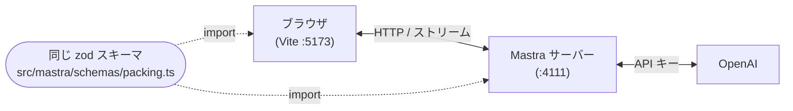

# Step 13. 型付きクライアント：フロントから型のまま呼ぶ（65分）

Day1 の [Step 5](../day1/05-http-api.md) では `curl` でエージェントを叩きました。ここではその同じ
HTTP API を、**TypeScript のフロントエンドから型を保ったまま**呼びます。

**この Step のゴール**: エージェント側で定義した zod スキーマが、そのままフロントエンドの型になる
状態を作る。スキーマを1文字変えるとフロントのビルドが即座に落ちることを確認する。

**前提**: [day2/](../day2/) まで完了した `travel-agent/` が動いていること（`weatherTool` と Memory 入り）。

---

## 先に押さえる：Vite（ヴィート）とは何か

この Step では、フロントエンドの開発に **Vite** というツールを使います。初めて聞く人のために、
先に役割だけ説明します。

**一言でいうと**: TypeScript で書いたフロントエンドを、**ブラウザが読める形に変えて届けてくれる道具**です。
名前はフランス語で「速い」の意味で、起動の速さと、保存してから画面に反映されるまでの速さが売りです。

### なぜ要るのか

ブラウザが直接理解できるのは HTML・CSS・JavaScript だけです。手元のコードには、そのままでは
ブラウザが扱えないものが混ざっています。

| 手元のコード | そのままだと | Vite がやること |
|---|---|---|
| `main.ts`（TypeScript） | ブラウザは TypeScript を実行できない | JavaScript に変換して渡す |
| `import { MastraClient } from '@mastra/client-js'` | ブラウザは `node_modules` の場所を知らない | パッケージを探し出し、ブラウザが読める形で渡す |
| 本番に出すときの多数のファイル | 1ファイルずつ読み込むと遅い | 1つにまとめて小さくする（`vite build`） |

### 2つの役割

| コマンド | 役割 | 使う場面 |
|---|---|---|
| `vite` | **開発サーバー**。コードを保存するとブラウザに即反映される | 手元で動かして確認する（この Step で使う） |
| `vite build` | **本番用のビルド**。公開用の静的ファイルを作る | Web サイトとして公開する |

Mastra の `mastra dev` / `mastra build` とまったく同じ関係です。

### Mastra との関係（ここが混乱しやすい）

- Vite は**フロントエンド専用**です。Mastra サーバー（:4111）とは別の独立したプロセス（:5173）で、
  お互いを呼び出しません。
- Vite の仕事は、HTML や JavaScript を**ブラウザに配るだけ**です。エージェントを呼ぶのは、配られた
  コードを動かしている**ブラウザ自身**（`MastraClient`）で、その通信は Vite を経由しません。
  13-1 の図の「ブラウザ (Vite :5173)」は、「画面を配っているのが Vite」という意味です。
- そのため 13-4 では、Mastra 用と Vite 用で**ターミナルを2つ**使います。

### 押さえておくと迷わないこと

- **React や Vue 専用ではありません。** この Step では、フレームワークを使わない素の TypeScript と
  HTML で使います。
- **型チェックはしません。** Vite は TypeScript を JavaScript に変換するだけで、型エラーがあっても
  動きます。型の検査は TypeScript 本体（`tsc`）の役割で、13-6 で `npx tsc --noEmit` を使うのはそのためです。
- **次の Step の Next.js は Vite を使いません。** Next.js は自前のビルドの仕組みを持っています
  （[14-nextjs-chat.md](./14-nextjs-chat.md)）。この Step で Vite を選んだのは、設定が少なく、
  「サーバーとフロントを分ける」構成を最小の手間で作れるからです。

---

## 13-1. なぜクライアント SDK なのか（10分）

エージェントを外から呼ぶ方法は3つあります。

| 方法 | 書くもの | 型 | ストリーミング |
|---|---|---|---|
| `curl` | シェル | なし | 手で SSE を捌く |
| 素の `fetch` | URL・メソッド・ボディを自分で組む | 自分で書いた型（**実物とズレても気づけない**） | 自分でパースする |
| `@mastra/client-js` | メソッド呼び出し | SDK が持っている | `processDataStream()` で受ける |

素の `fetch` の問題は、型が**あるように見えて実物と繋がっていない**ことです。`interface` を手書きすれば
エディタの補完は効きますが、それはサーバー側の実装とは無関係な「宣言」にすぎず、エージェントの出力形式を
変えても誰も教えてくれません。

この Step では SDK を使うだけでなく、**エージェントとフロントで同じ zod スキーマを import する**ところまで
やります。ここが「Mastra が TypeScript ネイティブであること」の実利が出る場所です。Python 製の
フレームワークなら、サーバーの出力型とフロントの型は別々に書いて手で同期するしかありません。

> 💡 **API キーはフロントに置きません。** ブラウザが話す相手は Mastra サーバー（4111）だけで、
> `OPENAI_API_KEY` はサーバー側に留まります。この境界は Step 13-6 の CORS の話と
> セットで押さえてください。



## 13-2. 共有スキーマを切り出す（10分）

Day1 の [Step 3-3](../day1/03-response-modes.md) では `src/index.ts` の中に zod スキーマを直接書いて
いました。これを**独立したファイルに出して、エージェント側とフロント側の両方から import できる**
ようにします。

```ts
// src/mastra/schemas/packing.ts
import { z } from 'zod'

export const packingListSchema = z.object({
  destination: z.string().describe('行き先の都市名'),
  summary: z.string().describe('現地の気候の要点を1〜2行で'),
  items: z.array(
    z.object({
      name: z.string(),
      reason: z.string(),
      priority: z.enum(['must', 'nice-to-have']),
    }),
  ),
})

// ★ここが要。スキーマから TypeScript の型を導出する（二重管理が発生しない）
export type PackingList = z.infer<typeof packingListSchema>
```

`z.infer` はスキーマ定義から型を**計算して**作ります。`interface PackingList { ... }` と手書きするのとは
違い、スキーマを直せば型も必ず追従します。これから作るフロントエンドはこの型を使います。

> **注意**: このハンズオンの OpenAI では、基本形のスキーマ（`z.object` / `z.array` / `z.string` など）が
> そのまま通ります。なお Google のモデルは JSON Schema のサブセットしかサポートしておらず、`z.union` と
> `z.record` が使えません（[01-setup/02-llm.md](../../01-setup/02-llm.md) 6章）。共有スキーマにするとフロント側にも
> 影響が及ぶので、他プロバイダへ差し替える際はここで踏まないようにしてください。

## 13-3. Vite でフロントを足す（15分）

`travel-agent/` の中にフロントエンドを同居させます。**別プロジェクトにしない**のが肝で、同じ
`package.json` / 同じ `tsconfig.json` の下に置くからこそ `src/mastra/schemas/packing.ts` を
相対パスで import できます。

### 手順 1. パッケージを入れる

```bash
cd ~/work/mastra-handson/travel-agent
npm install @mastra/client-js@latest
npm install -D vite
```

### 手順 2. `package.json` に `scripts` を足す

`package.json` の `scripts` に2つ足します。

```json
{
  "scripts": {
    "dev": "mastra dev",
    "web": "vite",
    "build": "mastra build",
    "build:web": "vite build"
  }
}
```

<details>
<summary>💡 この4つの <code>scripts</code> は何をするもの？（クリックで開く）</summary>

`scripts` は「`npm run <名前>` で実行したいコマンドの別名」を登録する場所です。左辺が `npm run` の
後ろに書く名前、右辺が実際に走るコマンドです。`mastra` は Mastra 側のツール、`vite` はフロントエンド側の
ツールなので、同居させているこのプロジェクトでは2系統を別の名前で登録しています。

| スクリプト | 実行されるもの | 何をするか | この Step での出番 |
|---|---|---|---|
| `"dev": "mastra dev"` | Mastra CLI | Mastra サーバーと Studio を**開発モード**で起動する（:4111）。コードを保存すると自動で再読み込みされる | 13-4 の「ターミナル1」で使う |
| `"build": "mastra build"` | Mastra CLI | エージェントやワークフローを**本番用にバンドル**し、`.mastra/output/` に出力する（[Step 12](../day2/12-build.md)） | 使わない |
| `"web": "vite"` | Vite | フロントエンド（`web/`）の**開発サーバー**を起動する（:5173）。TypeScript を即座に変換し、保存するとブラウザへ反映する | 13-4 の「ターミナル2」で使う |
| `"build:web": "vite build"` | Vite | フロントエンドを**本番用の静的ファイル**（HTML / JS / CSS）にまとめる。`root: 'web'` なので出力先は `web/dist/` | 使わない |

- **`dev` / `web`** は「手元で動かして確認する」コマンド、**`build` / `build:web`** は「公開用の成果物を作る」
  コマンドです。この Step で実際に叩くのは `dev` と `web` の2つだけです。
- **`npm run` が要ります。** `dev` と打つだけでは動かず、`npm run dev` と書くと、`scripts` の右辺の
  `mastra dev` が実行されます。`run` を省略できるのは `npm start` / `npm test` などの一部だけで、
  `npm dev` は使えません（`pnpm dev` や `yarn dev` なら省略できますが、このハンズオンは npm です）。
- **グローバルインストールは不要です。** `npm run` は `node_modules/.bin/` を PATH に足してから実行する
  ので、`mastra` や `vite` を `npm install -g` していなくても動きます。`npx mastra dev` と直接打っても
  同じ結果になりますが、`scripts` に登録しておけば毎回長いコマンドを打たずに済みます。
- **`build:web` の `:` に特別な意味はありません。** `build` と区別するための名前の付け方（慣習）です。

`dev` / `build` の登録そのものは [Step 2](../day1/02-first-agent.md) で行っています。この Step で足したのは
`web` と `build:web` の2つです。

</details>

### 手順 3. `vite.config.ts` を作る

`vite.config.ts` をプロジェクト直下に作成:

```ts
// vite.config.ts
import { defineConfig } from 'vite'

export default defineConfig({
  root: 'web', // index.html の置き場所。src/ は Mastra のものなので分ける
  server: {
    host: true, // DevContainer から VS Code のポート転送に拾わせるため
    port: 5173,
    fs: {
      // web/ の外にある src/mastra/schemas/ を import するため明示的に許可する
      allow: ['..'],
    },
  },
})
```

> **落とし穴**: `fs.allow` を書かないと、Vite が `web/` の外のファイルを配信しようとして
> `The request url is outside of Vite serving allow list` で止まることがあります。
> 共有スキーマを import する構成では必ず入れてください。

<details>
<summary>💡 <code>vite.config.ts</code> を1行ずつ読む（クリックで開く）</summary>

`vite.config.ts` は **Vite への指示書**です。`npm run web` で Vite が起動するとき、最初にこのファイルを読みます。
書いてあるのは「どのフォルダを起点にするか」と「開発サーバーをどう公開するか」の2つだけです。

| 行 | 意味 |
|---|---|
| `import { defineConfig } from 'vite'` | 設定を書くための補助関数 `defineConfig` を読み込む。渡した値をそのまま返すだけで、エディタの補完を効かせるために使う |
| `export default defineConfig({ ... })` | 設定をこのファイルの「答え」として書き出す。Vite はこれを読む |
| `root: 'web'` | **プロジェクトの起点フォルダ**。`index.html` はここに置く。既定は `travel-agent/` 直下だが、直下の `src/` は Mastra のものなので `web/` に分けた |
| `server: { ... }` | `npm run web` で起動する**開発サーバー**の設定 |
| `host: true` | 外からの接続も受け付ける。既定は「同じマシンの中」だけで、DevContainer の中だと VS Code のポート転送が届かないことがある |
| `port: 5173` | 待ち受けるポート番号。Vite の既定値と同じで、`forwardPorts` に登録済みの番号に合わせている。使用中だと Vite は自動で次の番号に変えてしまうので、転送されていないポートで開いたときは疑う |
| `fs: { allow: ['..'] }` | Vite が**配信してよいファイルの範囲**。既定は `root`（`web/`）の中だけ。`'..'` は `root` の1つ上（`travel-agent/`）で、これで `src/mastra/schemas/` を import できる |

</details>

<details>
<summary>💡 <code>host: true</code> とは？ 同じ Wi-Fi の外からも見えるのか？（クリックで開く）</summary>

**何が変わるか**

サーバーは起動するとき、「どのネットワークの入口で接続を待つか」を決めます。`host` はその指定です。

| 設定 | 待ち受け先 | 接続できる相手 |
|---|---|---|
| 既定（`host` 無指定） | `localhost`（`127.0.0.1`） | **同じマシンの中**のプログラムだけ |
| `host: true` | `0.0.0.0`（すべての入口） | 同じマシンの中 **＋ ネットワーク越しの相手** |

`localhost` は「自分自身」を指す特別な宛先です。そこだけで待っているサーバーには、ほかのマシンや
コンテナからは届きません。

**DevContainer で指定している理由**

```
Windows（ブラウザ） ──ポート転送──▶ DevContainer（Vite :5173）
```

ブラウザは Windows 側、Vite はコンテナの中にいるので、ブラウザから見ると Vite は「外のマシン」です。
`host: true` にしておけば、どの転送経路からでも届きます。ただし VS Code のポート転送は `localhost` だけで
待っていても動く場合が多く、**無いと必ず動かない設定ではありません**。IPv4 / IPv6 の食い違いなど、
環境による取りこぼしを防ぐ保険です。

**どこまで届くか**

| 相手 | 届くか |
|---|---|
| 自分の PC 内 | 届く |
| 同じ Wi-Fi や同じ有線 LAN の端末 | 届く（PC 側で転送・公開されている場合） |
| 別のネットワーク（インターネット側）の端末 | 通常は届かない（家庭用ルーターが外からの通信を遮断する） |

ただし「一切届かない」とは言えません。次の場合は外から届くことがあります。

- カフェや学校の Wi-Fi のように、**知らない人も同じ LAN に入っている**
- 社内 VPN などで**同じネットワークにつながっている**
- ルーター側でポート開放や UPnP をしている
- VS Code のポートを `Public` にした（Codespaces や Dev Tunnels のとき。ローカルの DevContainer には無い）

DevContainer では、Windows 側に公開されるのは VS Code が転送したポートだけで、転送は既定で自分の PC の
`localhost` に張られます。`host: true` が効いているのは**コンテナの中**の話で、このハンズオンの使い方なら
同じ Wi-Fi の端末からも通常は見えません。素の PC で `host: true` を試すときは、信頼できるネットワークで
使ってください。

</details>

### 手順 4. `tsconfig.json` を直す

`tsconfig.json` を2箇所直します。ブラウザの API（`document` など）を使うので `lib` に `DOM` が要ります。

```json
{
  "compilerOptions": {
    "target": "ES2022",
    "module": "ES2022",
    "moduleResolution": "bundler",
    "esModuleInterop": true,
    "forceConsistentCasingInFileNames": true,
    "strict": true,
    "skipLibCheck": true,
    "noEmit": true,
    "allowImportingTsExtensions": true,
    "lib": ["ES2022", "DOM", "DOM.Iterable"],
    "outDir": "dist"
  },
  "include": ["src/**/*", "web/**/*"]
}
```

変えたのは **`lib` の追加**と **`include` に `web/**/*` を足した**ことの2点です。

<details>
<summary>💡 <code>tsconfig.json</code> を1行ずつ読む（クリックで開く）</summary>

`tsconfig.json` は **TypeScript への指示書**です。「どの書き方を許すか」「どのファイルを検査するか」を決め、
エディタの赤線と `npx tsc --noEmit` はこれを基準に動きます。大きく3つに分けて読むと整理できます。
★ は、この Step で変えた行です。

**① どの JavaScript として扱うか**

| 行 | 意味 |
|---|---|
| `target: "ES2022"` | 2022 年版の JavaScript の書き方を前提にする |
| `module: "ES2022"` | `import` / `export` をそのまま使う（`package.json` の `"type": "module"` と揃える） |
| `moduleResolution: "bundler"` | `import` の行き先の探し方。Vite のようなバンドラーの流儀に合わせる |
| `esModuleInterop: true` | 古い形式（CommonJS）のパッケージも `import x from '...'` で読めるようにする |
| `allowImportingTsExtensions: true` | `from '../src/mastra/schemas/packing.ts'` のように**拡張子 `.ts` を付けた import** を許す（13-5 のコードが該当）。`noEmit` とセットで必要 |

**② 型チェックの厳しさと出力**

| 行 | 意味 |
|---|---|
| `strict: true` | 厳格な型チェックを一括で有効にする。`null` の見落としや暗黙の `any` を防ぐ |
| `forceConsistentCasingInFileNames: true` | `import` のファイル名の大文字小文字が実物とズレたらエラーにする（Windows / Mac では動き、Linux では動かない事故を防ぐ） |
| `skipLibCheck: true` | `node_modules` の型定義ファイル（`.d.ts`）の検査を飛ばす。他人のライブラリの型エラーに巻き込まれず、速くもなる |
| `noEmit: true` | 型チェックだけして、JavaScript のファイルは出力しない。変換は Vite と `mastra` が担当するため |
| `outDir: "dist"` | JavaScript を出力する場合の出力先。`noEmit` なので実際には使われない |

**③ 使える API と検査対象**

| 行 | 意味 |
|---|---|
| ★ `lib: ["ES2022", "DOM", "DOM.Iterable"]` | 使える組み込み API の型定義の一覧。`ES2022` は標準の JavaScript、**`DOM` は `document` / `HTMLElement` などブラウザの API**、`DOM.Iterable` は `querySelectorAll` の結果などを `for...of` で回すためのもの。**`DOM` が無いと `document` が「存在しない」というエラーになる** |
| ★ `include: ["src/**/*", "web/**/*"]` | 検査する対象。`src/` は Mastra 側、**`web/` がフロント側**。`**/*` は「配下のすべて」。書いていないフォルダは検査されない |

</details>

### 手順 5. `web/index.html` を作る

`web/index.html`:

```html
<!doctype html>
<html lang="ja">
  <head>
    <meta charset="UTF-8" />
    <title>旅行の持ち物アシスタント</title>
  </head>
  <body>
    <h1>旅行の持ち物アシスタント</h1>
    <input id="query" size="50" value="来週、札幌に2泊で行きます" />
    <button id="ask">聞く（ストリーム）</button>
    <button id="list">持ち物リストをもらう（構造化）</button>

    <pre id="text"></pre>
    <ul id="items"></ul>

    <script type="module" src="./main.ts"></script>
  </body>
</html>
```

## 13-4. `MastraClient` でストリーミング表示する（10分）

```ts
// web/main.ts
import { MastraClient } from '@mastra/client-js'

const client = new MastraClient({
  baseUrl: 'http://localhost:4111',
})

// 'travel-agent' は Agent の id（src/mastra/agents/travel-agent.ts で付けたもの）
const agent = client.getAgent('travel-agent')

// querySelector は見つからないと null を返すので、見つからなければ例外にする
function getElement<T extends Element>(selector: string): T {
  const el = document.querySelector<T>(selector)
  if (!el) {
    throw new Error(`要素が見つかりません: ${selector}`)
  }
  return el
}

const textEl = getElement<HTMLPreElement>('#text')
const queryEl = getElement<HTMLInputElement>('#query')
const askButton = getElement<HTMLButtonElement>('#ask')

askButton.addEventListener('click', async (): Promise<void> => {
  textEl.textContent = ''

  const response = await agent.stream(queryEl.value, {
    // Day2 で入れた Memory を使う。ブラウザをリロードしても会話が続く
    memory: { resource: 'user-taro', thread: 'web-demo' },
  })

  await response.processDataStream({
    onChunk: async (chunk): Promise<void> => {
      if (chunk.type === 'text-delta') {
        textEl.textContent += chunk.payload.text
      }
      if (chunk.type === 'tool-call') {
        console.log('ツール呼び出し:', chunk)
      }
    },
  })
})
```

ターミナルを**2つ**開いて、両方を起動します。

```bash
# ターミナル1
npm run dev     # Mastra サーバー + Studio → :4111
```

```bash
# ターミナル2
npm run web     # Vite → :5173
```

http://localhost:5173 を開いて「聞く（ストリーム）」を押すと、文字が流れながら出てきます。
**ブラウザの DevTools コンソールに `tool-call` が出る**ことも確認してください。`weatherTool` が
サーバー側で呼ばれたことが、フロントにもイベントとして届いています。

> 💡 ポート 5173 は `.devcontainer/devcontainer.json` の `forwardPorts` に入れてあります
> （[01-setup/01-environment.md](../../01-setup/01-environment.md) §3）。ブラウザが開かない場合は
> VS Code の「ポート」パネルで 5173 が転送されているか確認してください。

<details>
<summary>💡 ポートの公開範囲を VS Code で確認するには？（クリックで開く）</summary>

**開き方**

1. 画面下部のパネルで、ターミナルの隣にある **「ポート」タブ**（英語表示では `PORTS`）を開く。
2. 見当たらないときは、`Ctrl+Shift+P` でコマンドパレットを開き、`Ports: Focus on Ports View` を実行する。

**見る場所**

| 列 | 意味 |
|---|---|
| ポート | 転送されているポート番号（`5173`、`4111` など） |
| 転送されたアドレス | **ブラウザで開く宛先。公開範囲はここで確認する** |
| 実行中のプロセス | そのポートで待ち受けているプログラム（`vite`、`mastra` など） |
| 配信元 | 転送の登録元（`forwardPorts` なら自動転送として出る） |

- **「転送されたアドレス」が `localhost:5173` のようになっていれば**、自分の PC からだけ開ける状態です。
  同じ Wi-Fi の端末からは、通常つながりません。
- **`0.0.0.0:5173` や `192.168.x.x:5173` のような IP アドレスが出ていたら**、外部に開いている可能性が
  あります。設定（`Ctrl+,`）で `remote.localPortHost` を検索し、`allInterfaces` になっていないか確認して
  ください。既定は `localhost` です。
- **「表示範囲（Visibility）」の列は、ローカルの DevContainer では出ません。** `Private` / `Public` は
  GitHub Codespaces や Dev Tunnels で使う概念だからです。列が無いのは正常です。

</details>

## 13-5. 構造化出力を型付きで描画する（15分）

ここが本題です。`web/main.ts` に追記します。

```ts
// web/main.ts（追記）
import { packingListSchema, type PackingList } from '../src/mastra/schemas/packing.ts'

const itemsEl = getElement<HTMLUListElement>('#items')
const listButton = getElement<HTMLButtonElement>('#list')

function renderPackingList(list: PackingList): void {
  itemsEl.replaceChildren(
    ...list.items.map((item): HTMLLIElement => {
      const li: HTMLLIElement = document.createElement('li')
      // ↓ item.name / item.reason / item.priority はすべて補完が効く
      li.textContent = `[${item.priority}] ${item.name} — ${item.reason}`
      return li
    }),
  )
}

listButton.addEventListener('click', async (): Promise<void> => {
  textEl.textContent = '生成中...'

  // ★ 型引数 <PackingList> を明示する（理由は下の注を参照）
  const response = await agent.generate<PackingList>(queryEl.value, {
    structuredOutput: { schema: packingListSchema },
  })

  // parse を通すと「実行時の検証」と「型の確定」が同時に済む
  const list: PackingList = packingListSchema.parse(response.object)

  textEl.textContent = `${list.destination}: ${list.summary}`
  renderPackingList(list)
})
```

> **`generate<PackingList>` と型引数を書いている理由**: 省くと、TypeScript が `schema` から出力の型を
> 推論しようとして `TS2590: Expression produces a union type that is too complex to represent` という
> エラーになります（推論が複雑になりすぎるため）。これは型チェックだけのエラーで、実行時には影響せず
> Vite でも動きますが、`npx tsc --noEmit` が通らなくなります（13-6 の実験の出力にも混ざります）。
> 型引数を明示すれば推論が要らなくなり、エラーは消えます。

`packingListSchema.parse()` を挟んでいるのが要点です。HTTP の向こうから来た値は本来 `unknown` であるべき
もので、`as PackingList` で黙らせるのは型システムに嘘をつく行為です。`parse()` なら**実行時に検証したうえで
戻り値の型が `PackingList` に確定する**ので、嘘がありません。LLM の出力が想定と違えばここで例外になります。

> **`zod` はブラウザでも動きます。** サーバー専用のライブラリではないので、スキーマをそのまま
> フロントに持ち込めます。これが「同じスキーマを共有する」構成が成立する理由です。

## 13-6. 型が本当に繋がっているか確かめる（5分）

**実験: スキーマのフィールド名を変えてみる**

`src/mastra/schemas/packing.ts` の `priority` を `importance` にリネームします。

```ts
      priority: z.enum(['must', 'nice-to-have']),
      // ↓ こう変える
      importance: z.enum(['must', 'nice-to-have']),
```

保存した瞬間、**`web/main.ts` の `item.priority` にエディタが赤線を引きます**。コマンドでも確認できます。

```bash
npx tsc --noEmit
```

```
web/main.ts - error TS2339: Property 'priority' does not exist on type ...
```

サーバー側のスキーマを直したらフロントのビルドが落ちる。これが「型がエンドツーエンドで繋がっている」
ということです。確認できたら `priority` に戻してください。

**CORS（Cross-Origin Resource Sharing：オリジン間リソース共有）について**

<details>
<summary>💡 そもそも CORS とは？（クリックで開く）</summary>

**一言でいうと**: ブラウザが、**別のオリジンへの通信を許可するかどうかを決める安全のための仕組み**です。

**オリジンとは**

URL のうち「**プロトコル + ホスト + ポート**」の組です。3つのうち1つでも違えば、別のオリジンになります。

| 役割 | URL | オリジン |
|---|---|---|
| フロントエンド（Vite） | `http://localhost:5173` | `http://localhost` + ポート `5173` |
| Mastra サーバー | `http://localhost:4111` | `http://localhost` + ポート `4111` |

この Step ではポートが違うので、フロントから Mastra サーバーを呼ぶ通信は**別オリジンへの通信**になります。

**なぜ制限があるのか**

悪意のあるページ上のスクリプトが、ログイン済みの別サイト（銀行など）へ勝手に通信して、情報を盗むのを
防ぐためです。ブラウザは、別オリジンへの通信を既定で許可しません。

**許可される流れ**

1. `:5173` のページが `:4111` を呼ぶ
2. ブラウザが、サーバーの応答ヘッダー `Access-Control-Allow-Origin` を確認する
3. 自分のオリジンが許可されていれば、結果をページに渡す。許可されていなければブロックし、
   ブラウザのコンソールに **CORS エラー**を出す

許可を出すのは**サーバー側**、判定して止めるのは**ブラウザ**です。

**押さえておくこと**

- **`curl` や、サーバー同士の通信には関係しません。** CORS はブラウザだけの仕組みです。Day1 で
  `curl` が何も設定せずに動いたのはこのためです。
- **この Step では設定不要です。** Mastra の既定が `origin: '*'`（どこからでも許可）だからです。
  本番ではこの `origin` を、フロントのドメインだけに絞ります（下のコード）。

</details>

Mastra サーバーの CORS 設定は**既定が `origin: '*'`** なので、5173 から 4111 を叩くのは何も設定せずに
動きます。ただし本番でこのままにするのは論外なので、絞り方だけ見ておきます。

```ts
// src/mastra/index.ts
export const mastra = new Mastra({
  agents: { travelAgent },
  storage: new LibSQLStore({ id: 'mastra-storage', url: 'file:./mastra.db' }),
  server: {
    cors: {
      origin: ['http://localhost:5173'], // 本番はフロントのドメインに絞る
      credentials: false,
    },
  },
})
```

> ⚠️ `credentials: true`（Cookie を送る構成）にする場合、`origin` に `'*'` は**使えません**。
> 具体的なオリジンを列挙する必要があります。認証を載せるときに必ずぶつかる制約です。

---

**チェックポイント**
- [ ] `MastraClient` からエージェントを呼び、ブラウザに応答をストリーム表示できた
- [ ] エージェントと同じ zod スキーマをフロントで import し、`z.infer` の型で描画できた
- [ ] スキーマのリネームでフロントの型エラーが出ることを確認した
- [ ] API キーがブラウザに渡っていないこと（通信相手が 4111 だけであること）を説明できる
- [ ] CORS の既定値と、本番で絞る必要がある理由を説明できる

次は [14-nextjs-chat.md](./14-nextjs-chat.md)。今回は「サーバーとフロントを分ける」構成でしたが、
次はそれを**1つの Next.js アプリに同居させる**構成を作り、両者を比べます。
